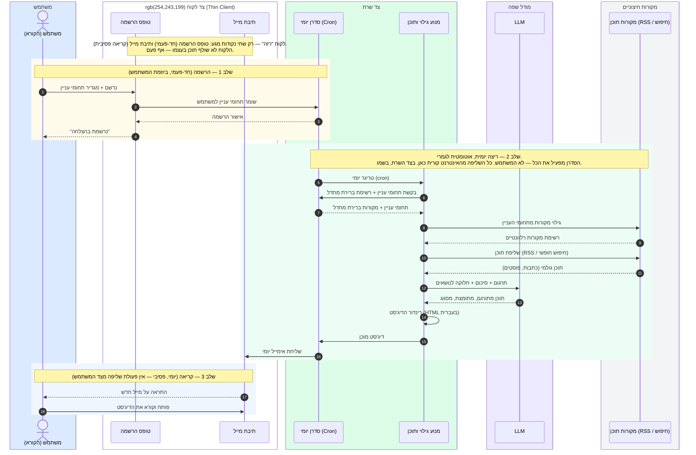

# NewsAgent — תרשים זרימה ארכיטקטוני (לפגישה עם נעמי)

מקור: `_bmad-output/forge/daily-digest-agent/forged-idea.md`

## מה מציג התרשים

תרשים רצף (sequence diagram) יחיד, עם 5 "קופסאות" (boxes) שמייצגות swimlanes:
**משתמש / צד לקוח / צד שרת / מודל שפה (LLM) / מקורות חיצוניים**.

שני אזורים צבועים (rect) מפרידים בין:
- **שלב 1 — הרשמה** (חד-פעמי, ביוזמת המשתמש)
- **שלב 2 — ריצה יומית** (אוטומטי לגמרי — הסדרן מפעיל, לא המשתמש)
- **שלב 3 — קריאה** (יומי, פסיבי)

הנקודה הארכיטקטונית המרכזית: הלקוח (טופס הרשמה + תיבת מייל) הוא "רזה" — הוא לא שולף תוכן בעצמו אף פעם. כל השליפה מהאינטרנט הפתוח קורית בצד השרת, בשם המשתמש.

## הדיאגרמה

